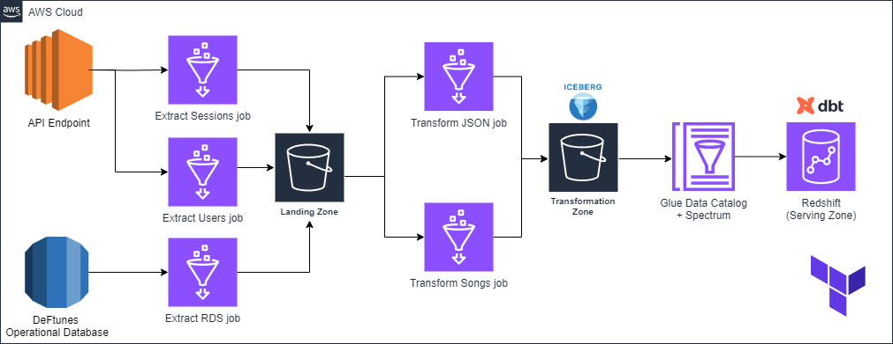
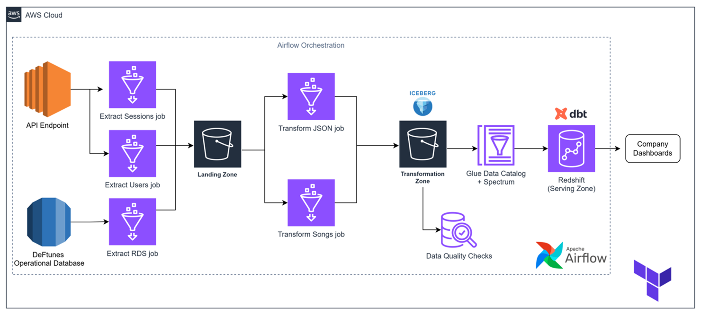

# Deftunes Music Streaming Data Pipeline

## 🚀 Project Overview
Deftunes is a cutting-edge music streaming platform. This repository showcases a robust data pipeline and exploratory data analysis (EDA) designed to extract actionable insights into song popularity, artist performance, and user engagement. The project demonstrates expertise in data engineering, analytics, and cloud infrastructure.

---

## 🏗️ Architecture
### Data Pipeline Architecture



---

## 📂 Repository Structure
```
├── dags/                     # Airflow DAGs for orchestration
├── data/                     # Raw data files
├── dbt_modeling/             # DBT models for data transformation
│   ├── models/               # SQL models
│   └── logs/                 # Logs for DBT runs
├── images/                   # Architecture diagrams and visual assets
├── scripts/                  # Helper scripts for setup and management
├── terraform/                # Infrastructure as code for AWS resources
└── EDA_defTunes.ipynb        # Jupyter Notebook for exploratory data analysis
```

---

## 🌟 Key Features
- **End-to-End ETL Pipelines**: Automated data extraction, transformation, and loading using Airflow and AWS Glue.
- **Dimensional Data Modeling**: Analytics-ready datasets built with DBT.
- **Insightful EDA**: Business KPIs analyzed, including song popularity, artist performance, and user engagement.
- **Cloud Infrastructure**: Terraform-managed AWS resources for scalability and reliability.

---

## 🛠️ Getting Started

### Prerequisites
- Python 3.8+
- Jupyter Notebook
- AWS CLI
- DBT
- Terraform

### Setup Instructions
1. **Clone the Repository**:
   ```bash
   git clone <repository-url>
   cd music-streaming-data-pipeline
   ```
2. **Install Dependencies**:
   ```bash
   pip install -r requirements.txt
   ```
3. **Configure AWS Credentials** for Terraform and Glue.
4. **Deploy Infrastructure**:
   ```bash
   cd terraform
   terraform init
   terraform apply
   ```
5. **Start Airflow**:
   ```bash
   ./scripts/restart_airflow.sh
   ```

---

## 📊 Exploratory Data Analysis

The EDA performed in this project focuses on uncovering insights into song popularity, artist performance, and user engagement. Below are the key analyses conducted:

### 1. Distribution of Song Popularity
- A histogram was created to visualize the distribution of song popularity scores.
- This analysis helps identify the range and frequency of popularity scores across all tracks.

### 2. Top-Performing Artists by Average Popularity
- Artists were ranked based on their average popularity scores.
- A horizontal bar chart was used to display the top 10 artists with the highest average popularity.

### 3. Song Popularity Over Time
- A line plot was generated to analyze how the average popularity of songs has changed over time.
- The x-axis represents the release dates, while the y-axis shows the average popularity.

### 4. Correlation Heatmap for Numerical Features
- A heatmap was created to visualize the correlation between numerical features in the dataset.
- This analysis highlights relationships between features such as energy, danceability, and loudness.

### 5. KPI Analysis
- **Most Popular Songs**: The top 10 most popular songs were identified based on their popularity scores, along with their respective artists.
- **Artist Performance Metrics**: Artists were evaluated based on the average popularity of their tracks and the number of songs they contributed.
- **User Engagement Trends**: Trends in song popularity over time were analyzed to understand user engagement patterns.

The EDA notebook (`EDA_defTunes.ipynb`) provides insights into the following business KPIs:

- **Song Popularity**: Distribution and top songs.
- **Artist Performance**: Streams and popularity metrics.
- **User Engagement**: Trends over time.

### How to Run the Notebook
1. Navigate to the repository root.
2. Launch Jupyter Notebook:
   ```bash
   jupyter notebook
   ```
3. Open `EDA_defTunes.ipynb` and execute the cells sequentially.
